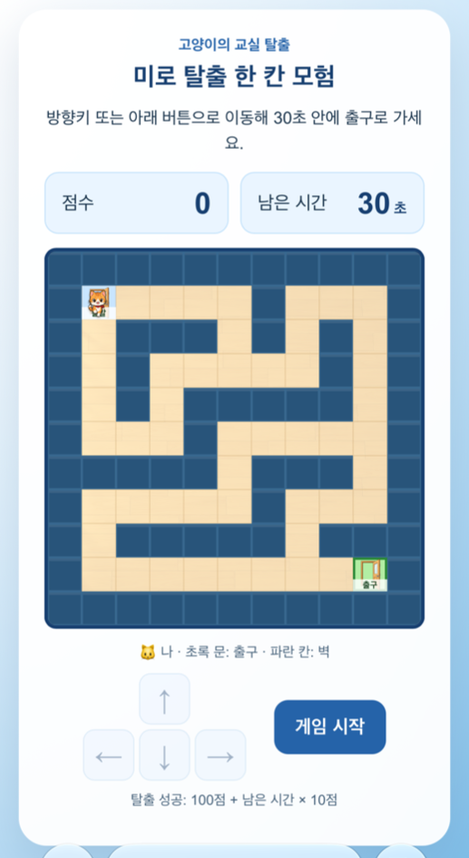
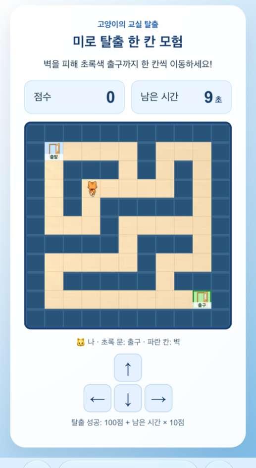
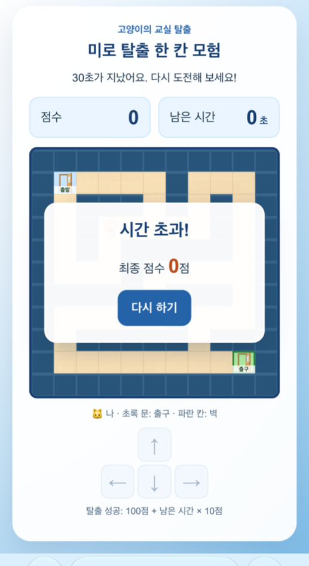

# minigame — 미로 탈출 한 칸 모험

게임사관학교 실행 예시. 고양이를 한 칸씩 움직여 30초 안에 교실 미로의 출구로 탈출하는 HTML·CSS·JavaScript 웹 게임입니다.

- [GitHub Pages에서 게임 실행](https://herjy6372.github.io/minigame/)

## 스크린샷

| 시작 화면 | 플레이 | 결과 |
|:---:|:---:|:---:|
|  |  |  |
